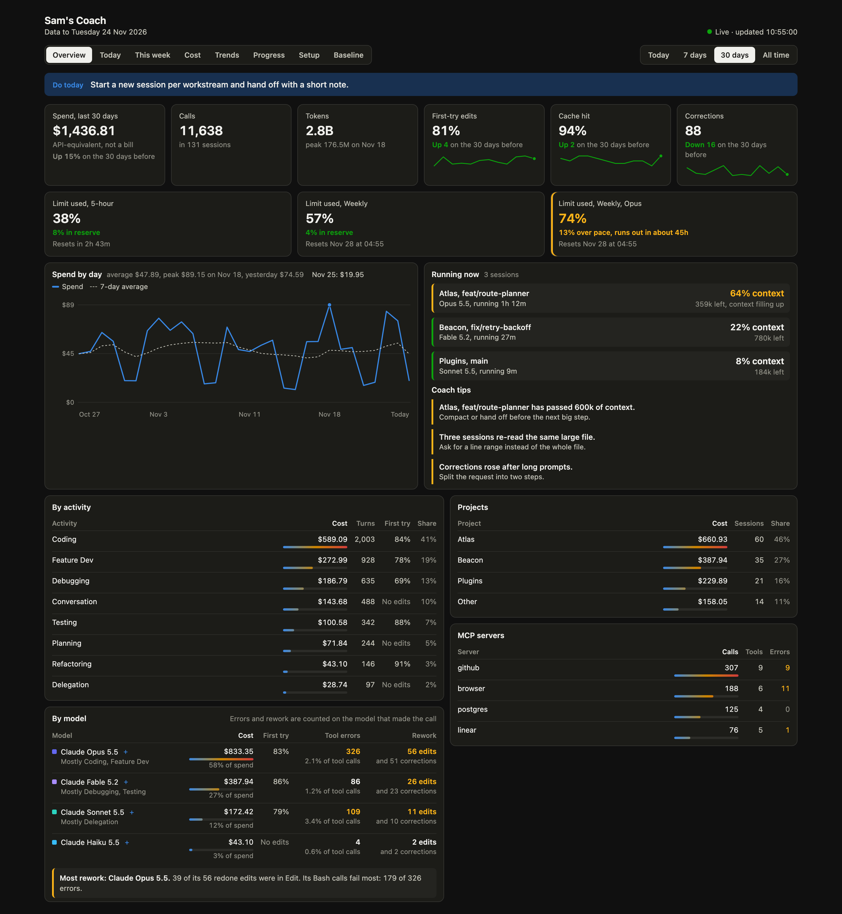
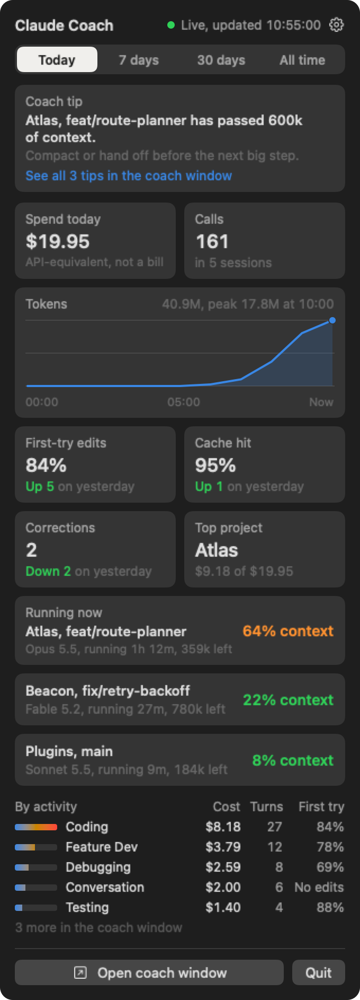

# 🏋️ Agentic Coach

Your Claude Code sessions leave a trail. Agentic Coach reads it on your own machine and tells you, kindly and with numbers, where your time and tokens went and which Claude Code feature would have helped.

## 🧩 Two ways to use it

**1. The plugin, inside Claude Code.** Type `/agentic-coach:coach` and you get a coaching recap: at most five items about yesterday, most costly first, each with the number that made it costly, the exact place in the session, and what to do instead. A weekly review adds proposed changes, applied only after your yes. Between recaps, a one-line nudge appears at the end of a turn only when something costly just happened. Every recap also rebuilds the coach page, one local page with your cost, trends and progress.



**2. The menu bar app, on a Mac.** "Claude Coach" sits in the macOS menu bar and shows today's spend. Click it for a panel with spend, calls, tokens, first-try edits, cache hit, corrections, what is running now and cost by activity, for Today, 7 days, 30 days or All time. It can open the coach page in a window of its own. The app is an add-on to the plugin: it only reads the file the plugin writes, `~/.claude/coach/live.json`. Its source is in [`menubar/`](menubar/) and you build it yourself (see [The menu bar app](#-the-menu-bar-app)).



## 🔐 Privacy

- 🏠 Everything stays on your machine. The plugin's scripts are plain Python with no network code, and the menu bar app makes no network calls.
- 👀 Your transcripts are only read, from `~/.claude/projects`. They are never changed, and nothing written in them is followed as an instruction.
- 🌐 The coach page is a local file. It is published only if you choose that in setup, and then as a private page on your own Claude account, with no session excerpts unless you say so.
- 💵 Cost figures are API-equivalent (your tokens at Anthropic's API list prices), not a bill.
- ✅ Fixes are applied only after your yes, one at a time, after you saw the diff. A scheduled run never applies anything.

## 🧰 What you need

- Claude Code.
- `python3` on your PATH (3.8 or newer). macOS and Linux have been used; Windows has not been tested.
- For the menu bar app only: macOS 14 or later, and Xcode to build it.

## 📦 Install

There are two routes. Use one.

### Route 1: straight from this repo

Type these two commands in Claude Code, one after the other:

```
/plugin marketplace add hkdeven/agentic-coach
```

```
/plugin install agentic-coach@agentic-coach
```

Then restart Claude Code.

### Route 2: from a marketplace that lists it

If your team has a plugin marketplace that lists `agentic-coach`, and you have already added that marketplace, type this in Claude Code, with your marketplace's name in place of `<marketplace>`:

```
/plugin install agentic-coach@<marketplace>
```

Then restart Claude Code.

## ⏰ Set it up

**Installing does not create the daily and weekly schedules.** Each person sets them up once, on their own machine.

1. Open Claude Code in the Claude desktop app.
2. Type this and press Enter:

   ```
   /agentic-coach:coach setup
   ```

3. Claude says which of the two schedules are missing (a daily recap at 07:30, a weekly review on Mondays at 08:00) and asks about each. Answer `yes` to each one you want.
4. Claude then offers the optional extras, one question at a time: publish the coach page privately, push notifications, the status line, and the live feed runner (macOS; the menu bar app needs it). Answer `yes` or `no` to each. Nothing is turned on without a yes.
5. To check at any time, type this. It only reports and changes nothing:

   ```
   /agentic-coach:coach setup status
   ```

If setup says the scheduling tools are not available, or you only use the terminal, follow [Set up the schedules](docs/GUIDE.md#set-up-the-schedules) in the guide.

## ▶️ Commands

Type one of these in Claude Code:

| You type | You get |
|---|---|
| `/agentic-coach:coach` | yesterday |
| `/agentic-coach:coach week` | the last 7 days, as a weekly review with proposals |
| `/agentic-coach:coach 2026-11-10` | that one day |
| `/agentic-coach:coach 2026-11-03 2026-11-09` | those days, both included |
| `/agentic-coach:coach compare` | the last 7 days against the 7 before ([more forms](docs/GUIDE.md#before-and-after)) |
| `/agentic-coach:coach audit` | what is set up but unused, as a table |
| `/agentic-coach:coach fixes` | the fixes the coach applied for you |
| `/agentic-coach:coach undo <key>` | take one applied fix back |
| `/agentic-coach:coach setup` | set up or repair the schedules, and the optional extras |
| `/agentic-coach:coach setup status` | check all of it; change nothing |

If no other plugin has a skill called `coach`, the short form `/coach` works too. You can also just ask: "give me my coaching recap for yesterday".

The coach page is rebuilt after every recap at `~/.claude/coach/site/index.html`. Open it in any browser. Its tabs are Overview, Today, This week, Cost, Trends, Progress, Setup and Baseline.

## 💻 The menu bar app

The app needs three things first:

- The plugin, installed and set up as above.
- The live feed runner turned on: in `/agentic-coach:coach setup`, answer `yes` to "Keep the live feed file fresh once a minute?". It writes `~/.claude/coach/live.json` once a minute and installs the small launcher the app uses to rebuild the coach page. Without it the panel says "No coach data yet".
- Xcode, selected (`xcode-select -p` points inside Xcode.app). It has been built with Xcode 27.2. A Mac with only the Command Line Tools can build it too: see [menubar/README.md](menubar/README.md#without-xcode-command-line-tools-only).

Build it. In a terminal, type these three lines, one after the other:

```sh
git clone https://github.com/hkdeven/agentic-coach.git
cd agentic-coach
sh menubar/build-app.sh
```

This makes `menubar/build/AgenticCoach.app`. It is unsigned and meant for the Mac it was built on.

Start it:

```sh
open menubar/build/AgenticCoach.app
```

The mark and today's spend appear in the menu bar; there is no Dock icon. Click the item to open the panel. The gear in the panel's header holds Compact and Launch at login, and Quit is at the foot of the panel. Everything else about the app is in [menubar/README.md](menubar/README.md).

## 📚 More detail

- [docs/GUIDE.md](docs/GUIDE.md): the schedules by hand, the coach page, cost, follow-through, evidence, before and after, set up but unused, applying a fix, the status line.
- [docs/SETTINGS.md](docs/SETTINGS.md): publishing the page, notifications, naming your projects, leaving work out, where things are written, every `config.json` key, turning the nudge off.
- [docs/LIVE-FEED.md](docs/LIVE-FEED.md): what the Overview shows, plan limits, the once-a-minute runner, and the fields of `live.json`.
- [menubar/README.md](menubar/README.md): the menu bar app in full.
- [docs/MAINTAINERS.md](docs/MAINTAINERS.md): the code layout, the tests, adding a detector, updating prices, releasing.
